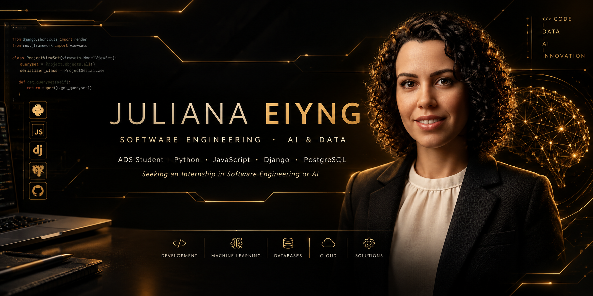
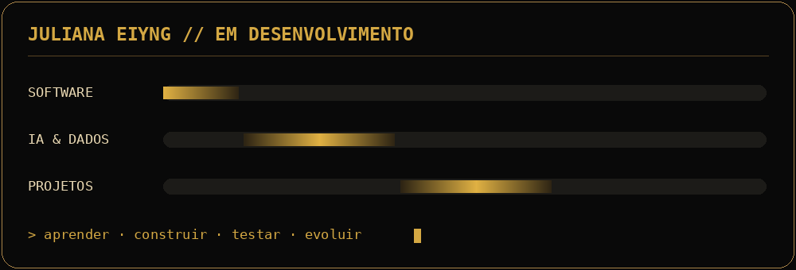

<div align="center">


</div>

## `01 // IDENTIDADE`

```python
juliana = {
    "nome": "Juliana Eiyng",
    "formacao": "Estudante de ADS",
    "tecnologias": ["Python", "JavaScript", "Django", "PostgreSQL"],
    "interesses": ["Engenharia de Software", "Inteligência Artificial"],
    "projetos": ["CRM Villa Terra", "Portfólio Kelvin Eiyng"],
    "objetivo": "Estágio em Engenharia de Software",
    "principio": "Aprender. Construir. Testar. Evoluir."
}
```

## `02 // TECNOLOGIAS`

<div align="center">


<br/><br/>


<br/>


<br/><br/><br/>


<br/><br/>


<br/>


<br/><br/><br/>


<br/><br/>


<br/>


<br/><br/>

<code>JULIANA &gt; APRENDER · CONSTRUIR · EVOLUIR ✓</code>

</div>

## `03 // TERMINAL`

```text
> iniciando apresentação...

[ OK ] Estudante de Análise e Desenvolvimento de Sistemas
[ OK ] Trabalhos freelancer de desenvolvimento web
[ OK ] CRM em produção
[ OK ] Projetos de estudo em IA e dados

PERFIL     : Estudante de ADS | Desenvolvedora freelancer
TECNOLOGIAS: Python | JavaScript | Django | PostgreSQL
PROJETOS   : CRM Villa Terra | Portfólio Kelvin Eiyng
INTERESSES : Engenharia de Software | Inteligência Artificial
OBJETIVO   : Oportunidade de estágio

> aprendendo e construindo... █
```

## `04 // PROJETOS_PRINCIPAIS`

<div align="center">


<br/><br/>

<h3>CRM Villa Terra Imobiliária</h3>

<p>
Sistema interno sob medida para até 30 corretores, com painéis para
corretores e administrador, gestão de imóveis, clientes e negociações,
funil Kanban e integração bidirecional com o site WordPress.
</p>


<br/>


<p>Código-fonte privado. Uso exclusivo da Villa Terra Imobiliária.</p>

<a href="https://julianaeiyng.github.io/portfolio/">

</a>

<br/><br/>

---

<h3>Portfólio profissional — Kelvin Eiyng</h3>

<p>
Site estático desenvolvido com HTML5 e CSS3, sem frameworks,
para apresentação profissional de um corretor de imóveis.
Reúne serviços, trajetória, depoimentos e links para WhatsApp,
Instagram e Facebook, com adaptação para desktop, tablet e celular.
</p>


<p>Trabalho freelancer · Layout dark com detalhes em dourado.</p>

<a href="https://kelvineiyng.me/">

</a>

<p><a href="https://kelvineiyng.me/">kelvineiyng.me</a></p>

<br/><br/>

<code>JULIANA EIYNG // PROJETOS DESENVOLVIDOS SOB MEDIDA ✓</code>

</div>

## `05 // OUTROS_PROJETOS`

<div align="center">


<br/><br/>

<h3>Analisador de Feedbacks — Projeto de estudo</h3>

<p>
Projeto pessoal que integra um Transformer pré-treinado para classificar
feedbacks de delivery em português. Inclui treinamento separado de um
classificador com TF-IDF e regressão logística e comparação de resultados.
</p>


<br/>


<br/><br/>

<a href="https://github.com/JulianaEiyng/analisador-feedbacks-ia">

</a>
<a href="https://juliana-feedbacks-ia.streamlit.app/">

</a>

<br/><br/>

---

<h3>Central do Corretor — Trabalho freelancer</h3>

<p>
Plataforma sob medida com comparativo financeiro SAC e Price,
projeção de parcelas e vencimentos, agenda de compromissos
e envio de propostas personalizadas pelo WhatsApp.
</p>


<br/><br/>

<a href="https://kelvin-eiyng.streamlit.app/">

</a>

<br/><br/>

---

<h3>Dashboard de Salários — Estudo guiado</h3>

<p>
Projeto de estudo da Imersão Dados da Alura, montado com código
e base de dados fornecidos pelos instrutores. O foco da etapa foi
publicar o dashboard no Streamlit Cloud com integração ao GitHub.
</p>


<p>Filtros interativos, indicadores salariais e gráficos dinâmicos.</p>

<a href="https://dashboard-salarios-dados.streamlit.app/">

</a>

<br/><br/>

<code>CÓDIGO E DADOS DO DASHBOARD FORNECIDOS PELA ALURA</code>

</div>

## `06 // PAINEL_DE_DESENVOLVIMENTO`

<div align="center">



<p><sub>Animação decorativa. As barras não representam níveis de habilidade.</sub></p>

</div>

## `07 // CONTATO`

<div align="center">


<br/><br/>

<a href="https://julianaeiyng.github.io/portfolio/">

</a>
<a href="https://www.linkedin.com/in/juliana-eiyng/">

</a>
<a href="mailto:jueiyng@gmail.com">

</a>

<p><a href="mailto:jueiyng@gmail.com">jueiyng@gmail.com</a></p>

<br/><br/>

<code>JULIANA EIYNG // APRENDENDO · CONSTRUINDO · EVOLUINDO</code>

<br/><br/>

<code>Obrigada por visitar meu perfil.</code>

<br/><br/>

<code>CONTATO &gt; ABERTA A OPORTUNIDADES DE ESTÁGIO ✓</code>

</div>
